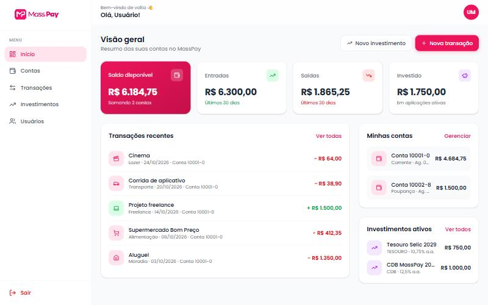
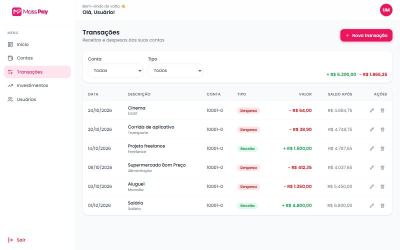
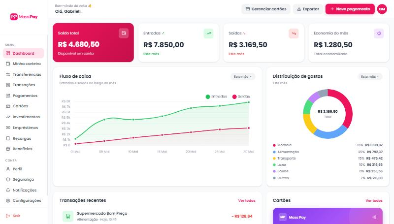

# MassPay

Plataforma de uma fintech fictícia que desenvolvi ao longo do primeiro ano do curso de Análise e Desenvolvimento de Sistemas na FIAP. O projeto evoluiu por etapas: começou como um dashboard em HTML e CSS e terminou como uma aplicação completa, com backend em Java (Spring Boot), banco de dados Oracle e frontend em React.

**Autor:** Gabriel Massimini Junqueira · RM 572596



## Estágio atual

A versão final tem duas partes que conversam por uma API REST:

- **Backend** (`backend/`): API em Spring Boot ligada ao Oracle da FIAP, com CRUD de usuários, contas, transações e investimentos, além de login por e-mail e senha.
- **Frontend** (`frontend/`): aplicação React (SPA) com login, página inicial, página de erro personalizada e páginas para consultar, cadastrar, editar e excluir cada uma das quatro entidades.

Regras de negócio que a API aplica:

- Receita soma ao saldo da conta. Despesa subtrai e é recusada se faltar saldo.
- Aplicar em um investimento tira o valor do saldo. Resgatar devolve o valor aplicado mais o rendimento.
- E-mail, CPF e número de conta não podem se repetir, e o usuário precisa ter 18 anos ou mais.
- Conta com movimentações e usuário com contas não podem ser excluídos.
- Cada resposta usa o status HTTP certo: 200, 201, 204, 400, 401, 404 e 409.



### O protótipo em HTML e CSS

O dashboard que fiz nas primeiras fases continua na raiz do repositório e publicado no GitHub Pages: https://gabrielmassimini.github.io/Projeto-Fintech-FIAP/. O visual do frontend React foi baseado nele.



## Tecnologias

- **Backend:** Java 21, Spring Boot 3.5 (Spring Web, Spring Data JPA e Bean Validation), Maven e Oracle Database (instância da FIAP)
- **Frontend:** React 19 com TypeScript, Vite, React Router, Context API, Tailwind CSS e react-icons
- **Protótipo:** HTML, CSS, Tailwind CSS, JavaScript e Chart.js

## Estrutura do repositório

```
backend/                API Spring Boot (model, repository, service, controller)
frontend/               Aplicação React (pages, components, services, contexts, hooks)
database/               Scripts SQL: criação das tabelas e dados de teste
docs/                   Imagens deste README
index.html, css/, js/   Protótipo em HTML e CSS (GitHub Pages)
```

## Como rodar

### Pré-requisitos

- JDK 21 (o IntelliJ pode baixar em *File > Project Structure > SDKs*)
- Node.js 20.19 ou mais novo (testado com o Node 24)
- Acesso à instância Oracle da FIAP (`oracle.fiap.com.br:1521:ORCL`)

### 1. Banco de dados

As tabelas ficam na instância Oracle da FIAP. Se o banco ainda não estiver preparado, rode no SQL Developer, nesta ordem:

1. `database/01_criar_banco_masspay.sql`: apaga e recria as 14 tabelas, as sequences e as categorias de transação.
2. `database/02_dados_teste.sql`: cria o usuário de teste, duas contas, transações e investimentos.

### 2. Backend (porta 8080)

1. **Credenciais do Oracle:** copie `backend/src/main/resources/db.properties.example` para `db.properties`, na mesma pasta, e preencha o usuário e a senha. Esse arquivo não vai para o GitHub. Se ele já existir (como no .zip da entrega), pule este passo.
2. **Rode a API**, de um destes jeitos:
   - **IntelliJ:** abra a pasta `backend`, escolha o JDK 21 e rode a classe `MasspayApiApplication`.
   - **Terminal:** dentro da pasta `backend`, rode `./mvnw spring-boot:run` (no Windows, `mvnw.cmd spring-boot:run`).
3. A API responde em `http://localhost:8080/api`.

### 3. Frontend (porta 5173)

Com o backend rodando, em outro terminal:

```bash
cd frontend
npm install
npm run dev
```

Abra `http://localhost:5173` no navegador. O endereço da API fica em `frontend/.env` (`VITE_API_URL`).

## Usuário de teste

| E-mail | Senha |
|---|---|
| `teste@masspay.com` | `MassPay@2026` |

Ele é criado pelo script `database/02_dados_teste.sql` e já tem duas contas, seis transações e dois investimentos. Também dá para cadastrar novos usuários pela página **Usuários**.

## Endpoints da API

| Recurso | Endpoints |
|---|---|
| Usuários | `GET` e `POST /api/usuarios` · `GET`, `PUT` e `DELETE /api/usuarios/{id}` |
| Contas | `GET` (aceita `?usuarioId=`) e `POST /api/contas` · `GET`, `PUT` e `DELETE /api/contas/{id}` |
| Transações | `GET` (aceita `?contaId=` ou `?usuarioId=`) e `POST /api/transacoes` · `GET`, `PUT` e `DELETE /api/transacoes/{id}` |
| Investimentos | `GET` (aceita `?contaId=` ou `?usuarioId=`) e `POST /api/investimentos` · `GET`, `PUT` e `DELETE /api/investimentos/{id}` |
| Categorias | `GET /api/categorias` · `GET /api/categorias/{id}` |
| Login | `POST /api/auth/login` |

Status de sucesso: `200` em consultas e atualizações, `201` ao criar e `204` ao excluir. Erros: `400` (dados inválidos ou regra de negócio), `401` (login inválido), `404` (registro não encontrado) e `409` (duplicidade ou registro em uso).

## O que aprendi

- Montar um layout de dashboard responsivo com Grid e Flexbox e transformar a barra lateral em menu no celular.
- Criar gráficos de linha e de rosca com o Chart.js.
- Organizar o CSS com variáveis para manter as cores e os espaçamentos consistentes.
- Modelar entidades com orientação a objetos em Java (encapsulamento, construtores, getters e setters).
- Publicar o site no GitHub Pages. Aqui tive um problema: meus caminhos começavam com `/` (por exemplo, `/css/style.css`). Isso funcionava no meu computador, mas no GitHub Pages o site fica dentro de uma subpasta, e o CSS e o JavaScript não carregavam. Nessa etapa de revisão e publicação usei o Claude (IA) como mentor. Com ele entendi a diferença entre caminhos absolutos e relativos, reorganizei os arquivos e tirei o JavaScript de dentro do HTML.
- Separar o backend em camadas (model, repository, service e controller) com Spring Boot e mapear as tabelas do Oracle com JPA (`@Entity`, `@SequenceGenerator` e `@ManyToOne`).
- Devolver o status HTTP certo em cada caso, com um tratador de erros (`@RestControllerAdvice`), em vez de deixar tudo virar erro 500.
- Usar `@Transactional` para gravar a transação e o novo saldo juntos, e `BigDecimal` para valores em dinheiro.
- Montar uma SPA em React com componentes, props, hooks, rotas protegidas e Context API para o login.
- Ligar o frontend ao backend com `fetch` e liberar o acesso pelo CORS.
- Guardar a senha do banco fora do Git e a senha dos usuários como hash SHA-256.

## Uso de IA

Desenvolvo o MassPay junto com IA. Uso o **Claude Code**, assistente de programação da Anthropic, como parceiro de programação: escrevo o código junto com ele, tiro dúvidas e peço revisão antes de publicar. Vou seguir trabalhando assim nas próximas etapas (banco de dados, backend em Java e APIs).

## Próximos passos

- Autenticação com token (JWT) no lugar do login simples
- Gráficos de fluxo de caixa e de gastos por categoria no React, como no protótipo
- Demais páginas da plataforma (cartões, transferências e metas)
- Publicar o backend e o frontend na nuvem

## Contato

Gabriel Massimini · [GitHub](https://github.com/GabrielMassimini) · [LinkedIn](https://www.linkedin.com/in/gabriel-massimini-junqueira/)
